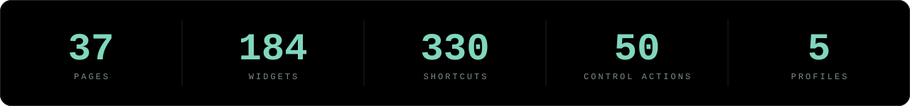
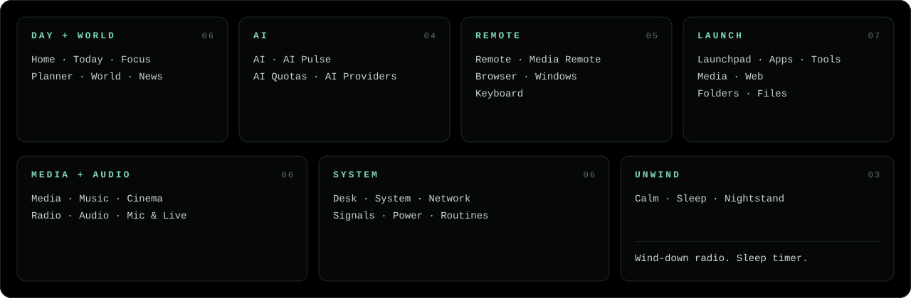

<div align="center">



<br>

**A personal command centre for one bench.**<br>
Audio, media, AI seats, system telemetry, remote control and sleep —<br>
one grid, one accent, no clutter.

<br>

[**Screenshots**](#screenshots) &nbsp;·&nbsp; [**Pages**](#pages) &nbsp;·&nbsp; [**Features**](#what-it-does) &nbsp;·&nbsp; [**Design rules**](#design-rules) &nbsp;·&nbsp; [**Config**](#config) &nbsp;·&nbsp; [**Direction**](#direction)

<br>



</div>

<br>

## SCREENSHOTS

Captured from the live V6.4 build on 25 November 2026. 1280 × 800, flat, no mockup frame — this is the screen as it runs.

<table>
  <tr>
    <td width="50%" valign="top">
      
      <br><sub><b>NIGHTSTAND</b> — clock, moon, next-hours forecast, sleep timer.</sub>
    </td>
    <td width="50%" valign="top">
      
      <br><sub><b>SLEEP</b> — wind-down radio, volume, moon phase, Goodnight / Screen Off / All Quiet / Mute.</sub>
    </td>
  </tr>
</table>

Provenance, and what was deliberately left out: [docs/screenshots/README.md](docs/screenshots/README.md).

<br>

## WHAT IT DOES

KNOX Console is the dashboard that runs the bench. It is a full command centre, not a macro deck — the widgets were rebuilt as custom HTML on top of the original grid, and it grew past that into its own thing.

<table>
  <tr>
    <td width="33%" valign="top"><b>🎚 AUDIO</b><br><sub>Mixer, outputs, profiles, push-to-talk, on-air.</sub></td>
    <td width="33%" valign="top"><b>📻 MEDIA</b><br><sub>Radio, cinema, music, Spotify, sleep radio. 50 control actions.</sub></td>
    <td width="33%" valign="top"><b>🤖 AI SEATS</b><br><sub>Claude, Codex, Antigravity, OpenCode — with quota tracking.</sub></td>
  </tr>
  <tr>
    <td valign="top"><b>📊 TELEMETRY</b><br><sub>CPU, RAM, GPU, temps, network, ping — live in the header.</sub></td>
    <td valign="top"><b>🖱 REMOTE</b><br><sub>Trackpad, media, browser, Windows and keyboard remotes.</sub></td>
    <td valign="top"><b>🚀 LAUNCH</b><br><sub>VS Code, Terminal, Git Bash, VLC, Task Manager and more.</sub></td>
  </tr>
  <tr>
    <td valign="top"><b>🔌 SYSTEM</b><br><sub>Power, VPN, routines, charge limits.</sub></td>
    <td valign="top"><b>🌙 UNWIND</b><br><sub>Nightstand, sleep timer, wind-down, one tap to quiet.</sub></td>
    <td valign="top"><b>🧩 CUSTOM HTML</b><br><sub>Widgets are hand-built HTML, not stock tiles.</sub></td>
  </tr>
</table>

<br>

## PAGES



Full inventory with widget counts: [docs/PAGES.md](docs/PAGES.md).

<br>

## DESIGN RULES

The look is deliberate and frozen. If it does not fit, it does not ship.

```
SURFACE   AMOLED BLACK
ACCENT    MINT  #80d7bd
STYLE     FLAT — RADIUS 16 — NO SHADOWS
DETAIL    ONE-PIXEL LINES, MONO LABELS
ORIGIN    TEENAGE ENGINEERING, STRIPPED BACK
RULE      FIT THE WIDGET TO THE DESIGN, NEVER THE REVERSE
```

<br>

## CONFIG

This repo holds a **sanitised example config**, not a live one:

```
config/KNOX-Personal-Console.example.json
```

Same structure as the live V6.4 config — same 37 pages, same widget counts, same 330 shortcuts — with personal data replaced. [docs/CONFIG.md](docs/CONFIG.md) explains every section.

**To use it**

1. Copy the example to your own config file. Never commit your live copy.
2. Fill in every `REPLACE_ME` — LAN tokens, Spotify client ID — and set `weather.city`, `weather.lat` and `weather.lon` to your own place.
3. Fix the shortcut commands: personal paths were replaced with bare executable names or `REPLACE_ME`. Point them at your own apps.
4. Import it into your PhoneBox-based console and adjust the layout to your screen.

**Auditable by design.** The script that produced the example is in the repo:

```
python scripts/sanitise-config.py <live-config.json> <example-config.json>
```

<br>

## DIRECTION

Planned, not done: port each page to **one single custom HTML widget** instead of many default widgets jammed together. One widget per page should mean better customisation, faster page changes and more out of the canvas — and it will most likely shrink the config by dropping the heaps of widget snippets. That last part is a bet, not a measurement yet.

<br>

## NOTES

- A personal build, shared as is. Built for one bench first, published so anyone can read, fork or borrow from it.
- The live config is **not** in this repo. It holds LAN tokens, a Spotify client ID, a home location and personal paths; the example replaces all of them.
- Issues and pull requests may not get a reply. Forking is welcome.

<br>

<div align="center">

<sub>

**ACKNOWLEDGEMENT** &nbsp;·&nbsp; Built on [PhoneBox](https://github.com/ersinkoc/phonebox) by ersinkoc — its infrastructure, setup and grid.<br>
**LICENSE** &nbsp;·&nbsp; MIT — see [LICENSE](LICENSE)

</sub>

</div>
